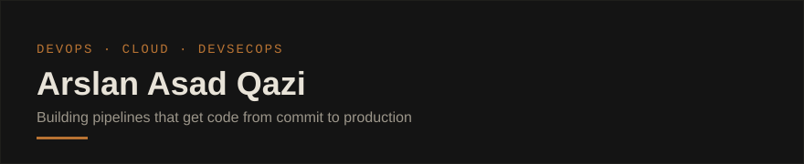

Final-year Computer Science student focused on DevOps, Cloud, and DevSecOps engineering.

**Cloud**

**CI/CD & IaC**

**Containers & Orchestration**

**DevSecOps**

**Monitoring**

**Web / Infra**

**Backend**

**Core Tools**

